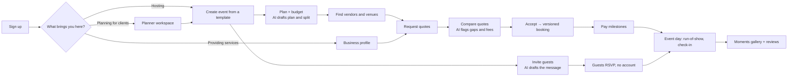
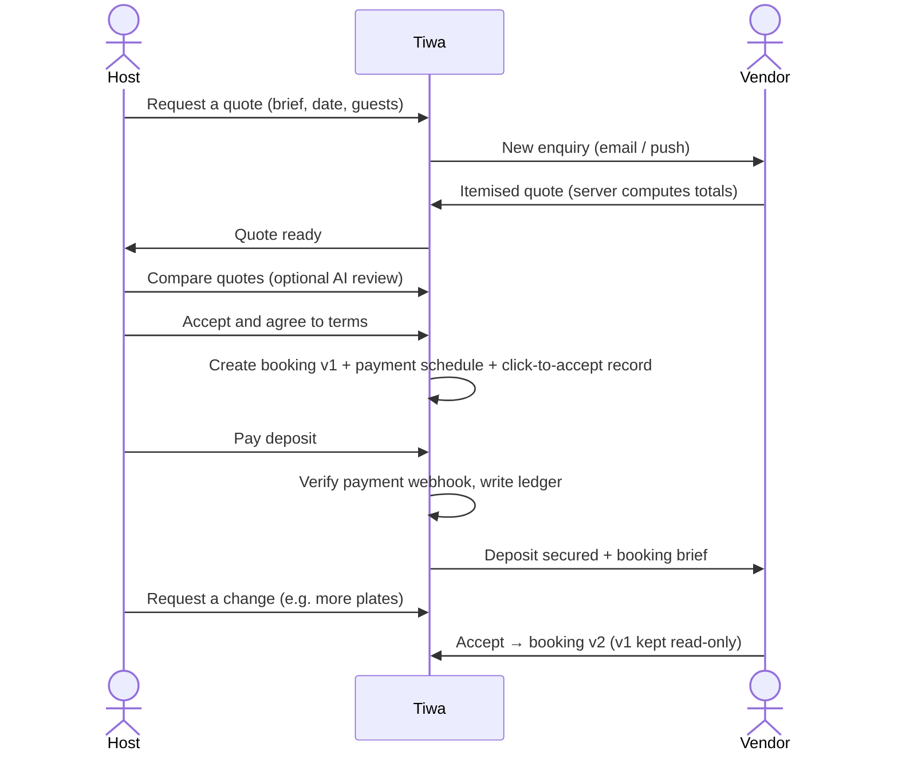
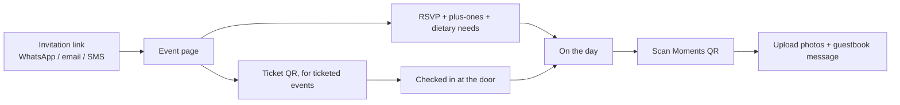
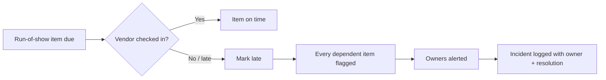
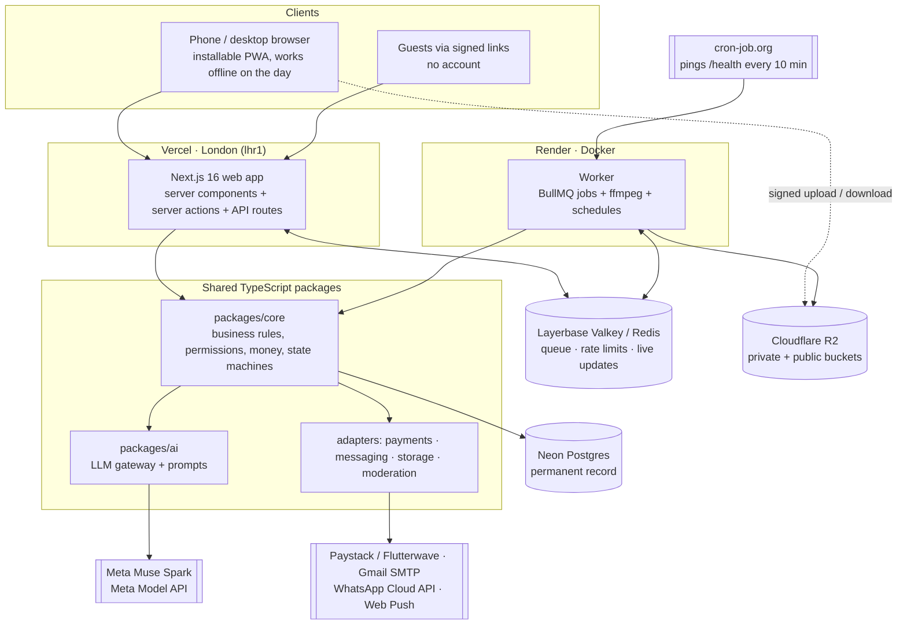

# Tiwa — plan any event, together

**Live app:** https://tiwa-events.vercel.app

Tiwa ("ours" in Yoruba) is a web app where hosts, planners, vendors and guests **plan, book, pay for, run and remember any event in one shared place**: birthdays, weddings, burials, church programmes, reunions, office parties, conferences, concerts and more.

It launches in Lagos, Nigeria, but nothing is hard-coded to one country, currency or kind of event. Those all come from configuration.

---

## Contents

1. [The problem](#1-the-problem)
2. [What Tiwa does](#2-what-tiwa-does)
3. [Who it is for](#3-who-it-is-for)
4. [How to use Tiwa](#4-how-to-use-tiwa)
5. [How AI helps you decide](#5-how-ai-helps-you-decide)
6. [User flows](#6-user-flows)
7. [How it works](#7-how-it-works)
8. [Architecture and stack](#8-architecture-and-stack)
9. [Repository layout](#9-repository-layout)
10. [Run it locally](#10-run-it-locally)

---

## 1. The problem

Planning an event in Nigeria today, and in most places, happens across **WhatsApp groups, phone calls, paper lists, bank transfers and spreadsheets**. That causes the same problems every time:

| Pain | What actually happens |
|---|---|
| **Information is scattered** | The guest list is in one chat, the budget in a notebook, vendor quotes in screenshots. Nobody has the full picture. |
| **Finding trusted vendors is hard** | People rely on referrals and Instagram. Prices are hidden, availability is unknown and reviews can't be trusted. |
| **Money is risky** | Deposits go by bank transfer with no record of what was agreed. A vendor who doesn't show up is hard to hold to account, and a vendor who isn't paid has no proof. |
| **Agreements change silently** | "You said 200 plates, not 150." With no versioned agreement, disputes turn into arguments. |
| **Guests are hard to manage** | RSVPs come back as WhatsApp replies. Headcounts, dietary needs and seating are guesswork until the day. |
| **The day itself is chaotic** | Nobody knows whether the DJ has arrived or the cake is late. One delay knocks everything after it with no warning. |
| **Memories are lost** | Photos sit on 200 guests' phones and never reach the host. The official photographer's pictures arrive months later by flash drive. |
| **Planners juggle many events at once** | Clients, leads, tasks, invoices and vendors for 10 events at a time, in their head and a notebook. |

## 2. What Tiwa does

Tiwa gives each event **one shared record** that everyone involved works from, with the right access for each person:

- **Plan:** create an event from a template (birthday, wedding, burial, conference…) that comes with a checklist, budget categories and suggested vendors.
- **Find and book:** search vendors, venues and planners, compare them, request quotes, accept the best one, and get a **versioned booking** with a payment schedule.
- **Pay:** pay deposits and balances inside Tiwa, or record offline payments with receipts. Every money movement goes into a double-entry ledger.
- **Invite:** send one-click invitations. Guests RSVP **without an account or app**.
- **Run the day:** a run-of-show timeline with owners and dependencies, vendor check-in, an incident log and guest check-in with tickets.
- **Remember:** "Moments" is a shared gallery. Guests scan a QR code and upload photos, and the hired photographer publishes the official album.
- **Talk:** chat between hosts, planners and vendors, plus notifications by email, push and WhatsApp.
- **Decide with AI:** an assistant drafts the plan and budget split, flags what's missing or risky in vendor quotes, shows what changes when the guest count moves, and writes invitations and updates in one prompt. It suggests; you decide. See [How AI helps you decide](#5-how-ai-helps-you-decide).

## 3. Who it is for

| Role | What they do in Tiwa | Account needed? |
|---|---|---|
| **Host** | Owns the event (a person, family, church, school, company or promoter) | Yes |
| **Co-host** | Helps the host, with only the permissions the host grants | Yes |
| **Planner** | A professional running events for clients, belonging to a planner business | Yes |
| **Vendor** | A service business: caterer, DJ, photographer, decorator, venue… | Yes |
| **Guest** | Invited or registered attendee | **No**: a signed link or ticket is enough |

One person can be a host on one event and a vendor on another. **Permissions come from your role on that event**, never from the account alone, and the server checks them on every action.

---

## 4. How to use Tiwa

Open **https://tiwa-events.vercel.app** on a phone or computer. It is an installable web app: on a phone, use your browser's "Add to Home Screen" to install it like an app.

### 4.1 Create an account

1. Tap **Create an account**.
2. Choose how to sign up:
   - **Username and password.** An email is optional, but add one to get booking updates and reset your password.
   - **Email link:** we email you a one-tap sign-in link.
   - **Google:** one tap with your Google account.
   - Phone sign-in is shown as *Coming soon*.
3. Choose what brings you to Tiwa: **I'm hosting an event**, **I plan events for clients** or **I provide event services**.

Forgot your password? Use **Forgot password?** on the sign-in page. The reset link lasts 10 minutes.

### 4.2 As a host: plan an event

1. **Create the event:** pick a type (for example *Birthday*), then enter the name, date, time, place, expected guests and total budget. Tiwa loads that type's checklist and budget categories.
2. **Plan:** work through the checklist. Each task can have a due date and an owner, and missed tasks are flagged.
3. **Budget:** see Planned, Committed, Paid and Outstanding for each category. Add expenses with receipt photos, and track contributions from family, committees or sponsors.
4. **Find vendors:** open **Vendors** or **Venues** from your event.
   - Filter by category, city, date, price, capacity and rating.
   - Shortlist the ones you like and compare them side by side.
5. **Request quotes:**
   - Send a short brief to up to 5 vendors at once, or tap **Request a quote** on any profile.
   - For venues, choose the date and time slot (morning, afternoon, evening, full day).
6. **Compare and accept:** quotes arrive itemised. Accept one, agree to the terms, and Tiwa creates a **booking**.
7. **Pay:** pay each milestone (for example a 30% deposit) inside Tiwa. If you paid by cash or transfer, record it with **I paid outside Tiwa**, and the vendor confirms receipt.
8. **Changes:** need more plates? Use **Request a change**. Both sides accept the new version, and the old one stays on record.
9. **Invite guests:**
   - Add guests by hand or import a CSV.
   - Send invitations by link, email or WhatsApp.
   - Guests RSVP from the link and add their plus-ones and dietary needs.
10. **On the day:**
    - Run the timeline from your phone.
    - Vendors check in with one tap.
    - Late items warn everyone whose task depends on them.
    - Scan guest tickets at the door.
11. **After:** share the **Moments** QR code so guests upload photos, download everything as a ZIP and review your vendors.

### 4.3 As a vendor or venue: get booked

1. Sign up and choose **I provide event services**, then enter your business name and city.
2. Go to **Business → Profile**:
   - Choose your categories and write a short bio.
   - Upload portfolio photos (up to 1 MB each for now).
   - Add packages with starting prices.
   - Upload your logo.
3. **Venues:** add each space (hall, garden, rooftop). For each, set its:
   - capacity by layout;
   - amenities;
   - prices per time slot;
   - refundable caution deposit;
   - house rules.
4. **Publish** your profile so it appears in search, and keep your availability calendar up to date.
5. Requests appear in **Quotes**:
   - Open one, build an itemised quote (or start from a saved package) and send it.
   - You can decline politely instead.
6. When the host accepts, you get the **booking brief**: date, venue, times, headcount and contact on the day. You can also see the payment status of each milestone.
7. Add your **payout bank account** and watch your **earnings** panel.

### 4.4 As a planner: run many events

1. Sign up and choose **I plan events for clients**.
2. Use the **dashboard** and **Today** to see approvals waiting, balances due and deadlines at risk across all your events.
3. Keep clients in the **Clients** CRM and track leads in the **Pipeline**: enquiry → proposal sent → won or lost.
4. Turn a client into an event in one step, and set your planning fee.
5. Send **branded proposals and invoices** (PDF, with your logo).
6. Keep a private **vendor book** of trusted vendors, notes and rates.
7. Add your team and assign tasks.

### 4.5 As a guest: no account needed

- Open the invitation link to see the event details, then RSVP and add your plus-ones.
- For ticketed events, buy or register for a ticket and show its QR code at the door.
- Scan the Moments QR code at the event to upload your photos and leave a message in the guestbook.

### 4.6 Try it with demo businesses

The live app can be loaded with **20 demo businesses**: 12 vendors, 5 venues and 3 planners. Their names and details are fictional but realistic, and the whole booking flow works with them.

| Type | Examples (username) |
|---|---|
| Vendors | Iya Ronke's Kitchen (`iyaronke.kitchen`), Lens & Light Studios (`lensandlight`), DJ Kaycee Vibes (`djkaycee`), Glam by Zainab (`glambyzainab`) … |
| Venues | The Palms Event Centre (`thepalms.lekki`), Eko Terrace Rooftop (`ekoterrace`), Capital Grand Ballroom (`capitalgrand`) … |
| Planners | Occasions by Temi (`occasionsbytemi`), Summit Corporate Events (`summitevents`), Heritage Ceremonies (`heritageceremonies`) |

**Try a full booking:**
1. In one browser, sign up as a host and create an event.
2. Open **Lens & Light Studios** and tap **Request a quote**.
3. In a private window, sign in as `lensandlight`. The password is the demo password (set with `DEMO_BUSINESS_PASSWORD` when loading; the default is in `apps/web/scripts/seed-demo-businesses.mts`).
4. As the vendor, open **Quotes** and send a quote.
5. Back as the host, accept the quote. The booking appears, ready for its deposit.

Payments on the live demo use a **test payment provider**, so no real money moves.

---

## 5. How AI helps you decide

Planning an event is a long chain of decisions: how to split the money, which quote to trust, what to do when 30 more guests are coming, how to tell 200 people about a change. Most hosts make these decisions once or twice in their life, without a professional's experience. Tiwa's AI assistant gives them that experience at the moment of each decision.

### 5.1 What the assistant does

| Decision | Without AI | With Tiwa's assistant |
|---|---|---|
| **"What do I need to do, and when?"** | Start from a blank page or copy a friend's list. | **Plan with AI** (Plan tab): from the event type, date, guest count and your notes, the assistant drafts a checklist with sensible due dates, that you tick to add to your plan. |
| **"How should I split my budget?"** | Guess, then run out of money for the cake. | **Budget split** (Money tab): it proposes a percentage for each budget category. Tiwa turns that into exact naira amounts that add up to your total to the kobo, and you review them before tapping **Apply**. |
| **"Which quote is actually better?"** | Read three PDFs line by line and miss the hidden travel fee. | **Compare with AI** (quote compare page): it reads every quote line by line and sorts what it finds into **Stands out, Leaves out, Unclear and Extra fees**, plus **questions to ask before you decide**, such as "Vendor B doesn't include setup" or "Vendor C charges a separate generator fee". |
| **"We now have 150 guests, not 120. What changes?"** | Call every vendor and work it out by hand. | **What if numbers change?**: it lists what each booking and the seating plan need to change (plates, chairs, tables, ushers), so you know who to ask for a change before the day. |
| **"How do I tell everyone?"** | Type the same message 200 times, or one generic broadcast. | **Write with AI** (Invites tab): type one sentence, such as "remind everyone the venue moved to The Palms, Lekki". The assistant writes the message with each guest's name and personal link, proposes who should get it and on which channel, and you send it with one tap. Buttons make it **Shorter, More formal, Warmer** or switch it to **Pidgin**. It also drafts vendor briefs and client updates, in **English or Nigerian Pidgin**. |
| **"Is the gallery accessible?"** | Photos have no descriptions. | **Auto alt text:** a background job adds short image descriptions to Moments photos for screen-reader users. It never overwrites a caption someone typed and is never used to identify people. |

### 5.2 How it keeps you in control

- **It suggests; you decide.** The AI never changes anything by itself. Every suggestion appears as a draft that you review, and nothing is saved, sent or paid until you press a confirm button such as **Apply** or **Send**.
- **It sees only what you're allowed to see.** Each AI request starts from the same permission check as the rest of the app. If a planner hides vendor prices, or you can't view money, the quote comparison runs **with no amounts in it at all**.
- **Private data stays private.** Guest names, phone numbers and emails are never sent to the model. Free text such as notes is masked before it leaves Tiwa.
- **Money is exact.** The model proposes percentages; Tiwa's own code does the arithmetic in whole kobo, so totals always match.
- **Costs are capped.** Every call has a token and time limit, and there's a daily allowance per user and per event. Each call is logged (without its prompt text) so usage can be audited.
- **It can be switched off.** The assistant sits behind the `ai.enabled` feature flag (`FLAG_AI_ENABLED`). Without a model key, the app uses built-in fake responses, so it runs and tests fully offline.

### 5.3 Under the hood

The assistant uses **Meta Muse Spark** through the Meta Model API (OpenAI-compatible chat completions in JSON mode), called from one gateway in `packages/ai`. The permission checks, masking, exact arithmetic and daily caps live in `packages/core/src/ai`, and each feature has its own prompt in `packages/ai/src/prompts` (plan, budget, compare, impact, message, caption).

---

## 6. User flows

### 6.1 The journey through Tiwa



### 6.2 From quote to paid booking



### 6.3 A guest's flow (no account)



### 6.4 The event day



---

## 7. How it works

### 7.1 One event, many people, server-enforced permissions
Every event has **members**, each with a role: host, co-host, planner, planner staff, vendor or photographer. Every page and action asks the server, "may this person do this on this event?" Examples:
- A vendor sees only their own booking brief and the guest count, never guests' phone numbers.
- A co-host can approve quotes only up to an amount the host sets.
- A planner decides whether the host can see vendor prices.

### 7.2 Quotes become versioned bookings
1. A **quote** is an itemised offer: line items, tax, service charge, travel fee, expiry and cancellation terms. The **server** computes all totals.
2. Accepting it creates a **booking (version 1)**. The booking records the scope, terms and payment schedule, and stores a click-to-accept record (time, user, IP).
3. A **change request** creates version 2, which both sides must accept. Old versions stay read-only, so there's always proof of what was agreed.
4. A booking's **status** (requested → confirmed → completed…) moves only through server rules.
5. **Venues** cannot be double-booked: the database allows one held or confirmed booking per space, date and time slot.

### 7.3 Money is handled carefully
- **Exact amounts.** All amounts are whole numbers in the smallest currency unit (kobo for naira), stored with a currency code, so rounding errors are impossible.
- **Payment modes:**
  - **Direct:** paid at checkout and split to the vendor.
  - **Offline:** recorded by hand with a receipt; both sides confirm.
  - **Held:** kept, then released per milestone. Built, but switched off until a licensed partner is in place.
- **Ledger.** Every movement is written to a **double-entry ledger** and reconciled daily.
- **Webhooks.** Payment notifications from the provider are verified and processed only once. A booking changes state only after a verified payment.

### 7.4 Fast pages, slow work in the background
The web app answers people instantly and hands slow work to a separate **worker** through a job queue. The worker handles:
- photo thumbnails and video processing (ffmpeg);
- sending invitations and notifications;
- guest CSV imports;
- ZIP downloads of galleries;
- scheduled jobs: expiring old quotes, holds and ticket reservations, deadline alerts, reminders, rating updates and media clean-up.

### 7.5 Files go straight to storage
Browsers upload photos and documents **directly to object storage** using short-lived signed links, so large files never pass through the web server. Photos are resized on the phone first. Private files (guest photos, receipts, verification documents) are only served through signed links. Each file is limited to 1 MB for now.

### 7.6 Guests without accounts
Guests are identified by a **signed link or ticket**, not an account. That keeps RSVPs and uploads to one tap. Abuse is controlled with rate limits and moderation.

### 7.7 Any event, any country
Event types, labels, currencies, taxes and payment providers live in **configuration** (`packages/config`), not in the screens. Adding a new event type or a new country is a configuration change.

---

## 8. Architecture and stack

### 8.1 System overview



### 8.2 How one action flows through the system

Take "host accepts a quote":

1. **Browser → server action.** The button calls a Next.js server action; there's no separate REST layer to keep in sync.
2. **Session and permission.** The action reads the Better Auth session, then `packages/core` resolves the person's role **on that event** and checks `quote.accept`. If it fails, nothing else runs.
3. **Validation.** Input is checked with Zod schemas shared by the client and the server.
4. **Business rule.** Core runs the booking state machine, computes totals in integer kobo, and writes the booking, its version, its milestones and the click-to-accept record in **one database transaction**.
5. **Outbox.** In the same transaction, an outbox row records "booking confirmed" and an audit entry is written.
6. **Background work.** The worker picks the event off the queue and sends the email, push and WhatsApp notifications, retrying with backoff if a provider is down.
7. **Live update.** A Redis pub/sub message refreshes the vendor's open page within seconds.

### 8.3 Layers

| Layer | What lives there | Rule |
|---|---|---|
| **UI** (`apps/web/app`, `packages/ui`) | Pages, layouts, design-system components, `messages/en.json` | Phone layout first; loading, empty and error states on every page; no business logic |
| **Server actions and API** (`apps/web`) | Thin handlers, webhooks, health | Authenticate, call core, return; never touch money or permissions directly |
| **Domain** (`packages/core`) | Events, guests, quotes, bookings, payments, ledger, budget, planner, AI orchestration | Every rule lives here, with unit tests; the only place state changes |
| **Adapters** (`packages/payments`, `messaging`, `storage`, `moderation`, `ai`) | One interface per outside service, each with a **Fake** | Swap providers by configuration; run and test with no keys |
| **Data** (`packages/db`) | Prisma schema, migrations, hand-written SQL indexes | Migrations only (never `db push`); money stored as `BigInt` minor units |
| **Config** (`packages/config`) | Typed env, feature flags, event types, vendor categories, currencies | Nothing country-, currency- or event-specific in code |

### 8.4 Stack

| Concern | Technology | Why |
|---|---|---|
| Web framework | Next.js 16 (App Router, React Server Components, server actions), React, Tailwind CSS | Fast first load on phones, server-side data and permissions, one deploy |
| Installable app | Serwist service worker, web manifest | Add to home screen; event-day pages work offline and sync later |
| Internationalisation | next-intl | Every string in `messages/en.json`; new languages without code changes |
| Auth | Better Auth (username + password, email magic link, Google; phone OTP ready but off) | Sessions in our own database, no vendor lock-in |
| Database | PostgreSQL (Neon) + Prisma, `citext` and `pg_trgm` | Relational integrity for money and bookings; fuzzy vendor search |
| Queue, cache, realtime | Valkey/Redis (Layerbase) + BullMQ + ioredis pub/sub | Retries, schedules and live updates without extra services |
| Files | S3 API on Cloudflare R2 (MinIO/S3Mock locally) | Direct browser uploads, no egress fees |
| Media processing | ffmpeg + image pipeline in the worker | Thumbnails, blur placeholders, EXIF GPS removal, video posters |
| AI | Meta Muse Spark via Meta Model API, JSON mode | One gateway, capped tokens, permission-filtered context |
| Email | react-email templates; Nodemailer over SMTP (Resend adapter ready) | Branded, table-based emails that render in every inbox |
| Payments | Paystack / Flutterwave adapters + fake provider; double-entry ledger | Card, transfer and USSD checkout; auditable money |
| Messaging | Email, Web Push (VAPID), WhatsApp Cloud API, SMS (Termii) adapters | Reach guests where they already are |
| Monorepo | pnpm workspaces + Turborepo, strict TypeScript, ESLint boundaries | Shared types end to end; packages can't import the wrong layer |
| Quality | Vitest, Playwright (390 px + 1280 px), Lighthouse CI, size-limit, axe | Every flow tested on phone and desktop sizes |
| Observability | Sentry, `/api/health`, worker `/health`, structured logs | Errors with context and without personal data |

### 8.5 Design principles

- **The server decides.** Permissions, booking and payment states, ticket capacity and review eligibility are enforced on the server, never trusted from the browser.
- **Money is integers.** `BigInt` minor units plus an ISO currency code, everywhere.
- **AI suggests, people confirm.** No AI output changes data without a confirm tap.
- **Private by default.** Guests need no account; contact details are visible only to roles that need them; uploads are scanned and GPS-stripped.
- **Risky features behind flags.** Held payments, payouts, bulk WhatsApp and AI default to off in production.
- **Any event, any country.** Templates, labels, currencies and taxes come from configuration.

---|---|
| Web | Next.js 16 (App Router, server components and server actions), React, Tailwind, next-intl, Serwist (PWA) |
| Auth | Better Auth: username + password, email magic link, Google; phone OTP ready but off |
| Data | PostgreSQL + Prisma (with hand-written indexes for search and availability) |
| Queue and cache | Redis-compatible (Valkey) + BullMQ, ioredis |
| Storage | S3-compatible (Cloudflare R2 in production, MinIO/S3Mock locally) |
| Email | react-email templates; Nodemailer over SMTP (Resend adapter available) |
| Payments | Adapter for Paystack / Flutterwave, plus a fake provider for demos and tests |
| Messaging | Email, web push, WhatsApp Cloud API and SMS adapters |
| Monorepo | pnpm workspaces + Turborepo, strict TypeScript |
| Tests | Vitest (unit and integration), Playwright (end-to-end at 390 px and 1280 px), Lighthouse CI, size-limit |
| Monitoring | Sentry, `/api/health` and the worker's `/health` |


---

## 9. Repository layout

```
apps/
  web/          Next.js app: pages, API routes, server actions, PWA, messages/en.json
  worker/       Background jobs (BullMQ), media processing, scheduled jobs, /health
packages/
  core/         Business rules: events, guests, quotes, bookings, payments, budget, planner, permissions (unit-tested)
  db/           Prisma schema, migrations, seed data
  config/       Typed env, feature flags, event types, vendor categories, locales, currencies
  ui/           Design system components (the only UI components pages may use)
  messaging/    Email/SMS/WhatsApp/push senders and email templates
  payments/     Payment provider adapters
  storage/      S3-compatible storage adapter
  moderation/   Upload safety-scan adapter
  ai/           AI assistant adapter
e2e/            Playwright end-to-end specs
docs/           Progress log, decision log, runbooks (deploy-free-stack.md)
```

---

## 10. Run it locally

**You need:**
- Node.js 22.
- pnpm 9 (`corepack enable && corepack prepare pnpm@9 --activate`).
- Docker running.
- These ports free: 3000, 5432, 6379, 9090/9001, 8025/1025.

```sh
cp .env.example .env     # local defaults work as-is
pnpm install
pnpm db:up               # Postgres + Redis + S3 + Mailpit in Docker, waits until healthy
pnpm db:migrate          # apply database migrations
pnpm db:seed             # demo host, events, guests, gallery, 40 vendors, venues, planners
pnpm db:seed:demo        # the 20 realistic demo businesses with sign-in owners
pnpm dev                 # web on http://localhost:3000 + worker
```

Emails sent locally are caught by Mailpit at http://localhost:8025.

| Command | Does |
|---|---|
| `pnpm dev` | Web app (port 3000) and worker together |
| `pnpm db:up` | Start local Postgres, Redis, S3 and Mailpit |
| `pnpm db:migrate` | Apply Prisma migrations |
| `pnpm db:seed` | Full demo data |
| `pnpm db:seed:planner` | Refresh only the planner demo data (its dates are relative to today) |
| `pnpm db:seed:demo` | Create or refresh the 20 demo businesses |
| `pnpm lint` | ESLint + Prettier |
| `pnpm typecheck` | `tsc --noEmit` across all packages |
| `pnpm test` | Vitest unit and integration tests |
| `pnpm e2e` | Playwright tests at phone and desktop width |
| `pnpm perf` / `pnpm size` | Lighthouse and JavaScript size budgets |
| `pnpm gate <n>` | Every automated check for build phase *n* |

---

