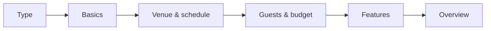
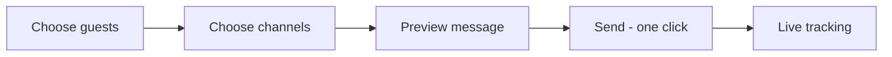
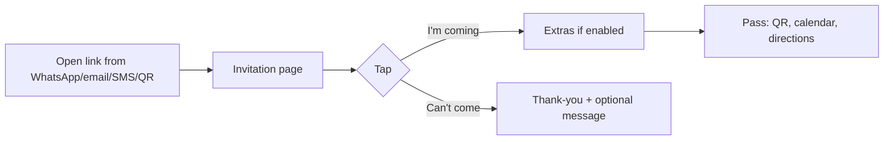
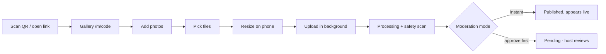
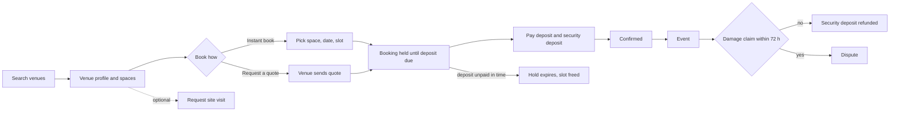

# user_flow.md — Tiwa User Flows

Each flow lists the actor, the entry point, the steps (with the route of each screen), edge cases and **acceptance checks**. Every acceptance check must become an automated Playwright test (file `apps/web/e2e/UF-XX-*.spec.ts`), run at **390 px** and **1280 px** widths. A flow is done only when all its checks pass at both widths.

Notation: `→` next screen · `[Button]` a button · `(PRD-ID)` requirement covered.

---

## Flow index

| ID | Flow | Actor | Phase |
|----|------|-------|-------|
| UF-01 | Sign up and onboarding | Anyone | P2 |
| UF-02 | Log in | Anyone | P2 |
| UF-03 | Create an event | Host / planner | P3 |
| UF-04 | Add co-hosts and set permissions | Host | P3 |
| UF-05 | Manage checklist and tasks | Host / planner | P3 |
| UF-06 | Build the guest list | Host / planner | P4 |
| UF-07 | Send one-click invitations | Host / planner | P4 |
| UF-08 | Guest receives invite and RSVPs | Guest | P4 |
| UF-09 | Small event: share one link or QR | Host | P4 |
| UF-10 | Guest uploads to Moments | Guest | P5 |
| UF-11 | Host moderates Moments and runs the slideshow | Host | P5 |
| UF-12 | Photographer delivers the Official album | Photographer | P5 |
| UF-13 | Vendor onboarding and profile | Vendor | P6 |
| UF-14 | Find vendors and request quotes | Host / planner | P6–P7 |
| UF-15 | Vendor sends a quote | Vendor | P7 |
| UF-16 | Accept a quote and create a booking | Host / planner | P7 |
| UF-17 | Pay a booking (Direct / Held / Offline) | Host | P8 |
| UF-18 | Milestone release and payout | System / host / vendor | P8 |
| UF-19 | Change request on a booking | Host / vendor | P7 |
| UF-20 | Budget and contributions | Host / planner | P9 |
| UF-21 | Planner daily dashboard | Planner | P10 |
| UF-22 | Public event registration and tickets | Organiser / attendee | P11 |
| UF-23 | Door check-in | Host / staff | P11 |
| UF-24 | Event day run-of-show | Planner / vendors | P12 |
| UF-25 | Close event and review vendors | Host / planner | P14 |
| UF-26 | Dispute | Host / vendor / admin | P8, P16 |
| UF-27 | AI: draft plan and compare quotes | Host / planner | P15 |
| UF-28 | Admin verifies a vendor | Admin | P16 |
| UF-29 | Find and book a venue (quote or instant book), with site visit and security deposit | Host / planner / venue | P6–P8 |
| UF-30 | Chat: client, planner and vendor conversations | Host / planner / vendor | P6 |
| UF-31 | Guest messages a vendor after the event | Guest / vendor | P6 |

---

## UF-01 Sign up and onboarding (ACC-01, ACC-02, ACC-03)

**Entry:** `/signup`, or any "Get started" button, or a planner/co-host invite link.

1. `/signup` — choose method: **Phone** (default; country code preselected from `DEFAULT_COUNTRY`), **Email**, or **Continue with Google**.
2. Phone: enter number → `[Send code]` → enter 6-digit OTP (auto-advances; paste supported; resend after 30 s).
3. `/onboarding/role` — "What brings you to Tiwa?" cards: **I'm hosting an event** · **I plan events for clients** · **I provide event services**. (Can add other roles later in settings.)
4. Host → `/onboarding/profile` (name, optional photo) → `/events/new`.
5. Planner or vendor → `/onboarding/business` (business name, categories, city, phone, optional logo) → creates Organization with user as `OWNER` → `/home`.
6. If the user arrived from an invite link (co-host, planner staff), skip step 3 and land on the invited event or organisation.

**Edge cases:** wrong OTP 5 times → 15-minute lock with message; phone already registered → log in instead; Google email matches existing phone account → offer to link after OTP.

**Acceptance checks**
- [ ] UF-01-1 Phone sign-up to `/events/new` completes in ≤ 4 screens.
- [ ] UF-01-2 OTP input accepts paste and auto-submits on 6 digits.
- [ ] UF-01-3 Vendor onboarding creates an Organization and Membership(OWNER).
- [ ] UF-01-4 After 5 wrong OTPs the form locks with a clear message.
- [ ] UF-01-5 Arriving from a co-host invite lands on that event with the CO_HOST role.

---

## UF-02 Log in (ACC-01)

1. `/login` → phone (OTP) / email (magic link) / Google.
2. Redirect to the `next` parameter or `/home`.

**Acceptance checks**
- [ ] UF-02-1 Magic link logs in once and expires after 15 minutes or first use.
- [ ] UF-02-2 Protected pages redirect to `/login?next=…` and return after login.

---

## UF-03 Create an event (EVT-01, EVT-02, EVT-03, EVT-04, EVT-13)

**Entry:** `[New event]` on `/home` or `/events`.

1. `/events/new?step=type` — grid of event types grouped by format (Private celebrations, Corporate, Public & ticketed, Community). Search box. Tap a card.
2. `step=basics` — name (pre-filled suggestion, e.g. "Ada's 40th Birthday"), date, start/end time, cover image (optional).
3. `step=venue` — venue search (map autocomplete) or "Venue not decided"; `[Add another day]` for multi-day; each day can have its own venue and programme items (from template). "Find a venue" opens venue search (UF-29) with the date and guest count filled in.
4. `step=guests` — expected guests (number), budget (MoneyInput in event currency), visibility (Private / Link only / Public; Public only for formats that allow it).
5. `step=features` — switches: Invitations (default OFF), Tickets (only if Public), Moments (default ON), "I'm working with a planner" (opens invite planner field).
6. `[Create event]` → server creates Event, EventParticipant(HOST), EventDays, checklist tasks and budget categories from the template → `/events/{id}` overview with a welcome banner.

**Edge cases:** date in the past → warning but allowed (for recording past events); closing the wizard keeps a draft (`Event.status = DRAFT`) and `/events` shows "Continue setup"; type changed after creation → template not re-applied, user asked whether to add the new template's tasks.

**Acceptance checks**
- [ ] UF-03-1 A birthday can be created in under 60 seconds through all steps.
- [ ] UF-03-2 Each step's input is saved; reloading resumes at the same step.
- [ ] UF-03-3 Checklist tasks and budget categories match the chosen template.
- [ ] UF-03-4 Tickets switch is hidden unless visibility is Public.
- [ ] UF-03-5 No event-type-specific text is hard-coded (labels come from config).

---

## UF-04 Add co-hosts and set permissions (EVT-06, EVT-07)

1. `/events/{id}/settings/members` → `[Add person]` → phone or email → role (Co-host, Planner, Planner staff) → permission presets: **View only**, **Contributor** (tasks, guests), **Finance** (money view/edit, approve up to ₦X), **Full**.
2. Invitee gets SMS/email/WhatsApp link → signs up/logs in → lands on the event.
3. Host can change or remove permissions at any time; removal takes effect immediately (session check on next request).

**Acceptance checks**
- [ ] UF-04-1 A "View only" co-host cannot open `/events/{id}/money` (server returns 403 page).
- [ ] UF-04-2 "Finance up to ₦100,000" co-host can approve a ₦80,000 quote but not a ₦150,000 one.
- [ ] UF-04-3 Removing a member blocks their next request to the event.

---

## UF-05 Manage checklist and tasks (EVT-03, EVT-05)

1. `/events/{id}/plan` — tasks grouped by timeframe ("12+ weeks before", "1 week before", "Event day", "After") with filters (mine, overdue, blocked).
2. Tap a task → sheet (mobile) / side panel (desktop): title, owner, due date, priority, status, notes, attachments, comments.
3. `[Add task]` inline at the top of each group. Swipe right (mobile) or checkbox to complete.

**Acceptance checks**
- [ ] UF-05-1 Completing a task updates the overview progress without a full reload.
- [ ] UF-05-2 Overdue tasks show in red with the number of days overdue.
- [ ] UF-05-3 Task changes appear for other members within 10 seconds.

---

## UF-06 Build the guest list (GST-01, GST-02, GST-03, GST-17, GST-19)

1. `/events/{id}/guests` — empty state: "Add your guests" with four options: **Type names**, **Paste a list**, **Import CSV**, **From contacts** (shown only where the Contact Picker API exists).
2. Paste: one guest per line, "Name, phone, email" in any order — parser detects phones and emails; preview table with fixes highlighted → `[Add 48 guests]`.
3. CSV: upload → map columns → preview → import (max 5,000 rows).
4. List view: search, filter by group / RSVP / checked-in; bulk actions (add to group, delete, send invite).
5. `[Headcount]` → report by RSVP, meal, group; `[Share with vendor]` creates a read-only link without contact details.
6. Tables: `[Tables]` tab → create tables with capacity → assign guests from a list.

**Edge cases:** duplicate phone/email → merge prompt; invalid phone → row marked, can still import without phone.

**Acceptance checks**
- [ ] UF-06-1 Pasting 50 mixed lines creates 50 guests with phones normalised to E.164.
- [ ] UF-06-2 CSV of 5,000 rows imports in under 30 seconds (worker job, progress bar).
- [ ] UF-06-3 Vendor headcount link shows counts and dietary needs but no names, phones or emails.

---

## UF-07 Send one-click invitations (GST-04, GST-05, GST-08–GST-14)

**Precondition:** Invitations switched ON (event settings or prompt on the guests page).

1. `/events/{id}/invites` → `[New invite]`.
2. **Who:** "All guests not yet invited" (default) / a group / hand-picked.
3. **How:** channel chips, multi-select: WhatsApp · Email · SMS · Link only. Tiwa picks the best channel per guest automatically if "Smart" is on (WhatsApp if phone, else email, else SMS).
4. **Message:** template with event name, date, venue, host name and personal link; editable text; preview per channel (WhatsApp bubble, email card, SMS 160-char counter). AI `[Improve wording]` if flag on.
5. `[Send to 148 guests]` → confirmation sheet showing counts per channel and SMS cost estimate → `[Send]`.
6. Worker sends in batches; `/events/{id}/invites` shows a live table: guest, channel, status (queued → sent → delivered → opened → yes/no), last activity.
7. WhatsApp free mode (bulk flag OFF): instead of sending, Tiwa shows a queue "Send on WhatsApp (1 of 148)" — each tap opens `wa.me/{phone}?text=…` in WhatsApp, then returns to Tiwa and moves to the next guest; marked "sent by you".
8. Reminders: toggle "Remind people who haven't replied" with days before the event (default 7 and 2); "Day-before reminder to attendees" default ON.
9. Updates: `[Send update]` → audience All / Attending only → message → send.

**Edge cases:** guest without phone or email → only Link/QR available, shown in a "Needs a link" list with copy buttons; provider failure → status FAILED with retry; host edits event time after invites → banner "Send an update to guests?".

**Acceptance checks**
- [ ] UF-07-1 From the invites page, sending to all guests needs exactly one confirm tap after choosing channels.
- [ ] UF-07-2 Each guest gets a unique token; two guests never share a link.
- [ ] UF-07-3 2,000 invites complete within 5 minutes with fake providers and respect per-provider rate limits.
- [ ] UF-07-4 Tracking table updates live (SSE) without reload.
- [ ] UF-07-5 At most 2 reminders are ever sent to one guest.
- [ ] UF-07-6 Invitations OFF hides the invites page and everything else still works.
- [ ] UF-07-7 WhatsApp free mode opens a correct `wa.me` URL with the personal link URL-encoded.

---

## UF-08 Guest receives invite and RSVPs (GST-07, GST-08, GST-15, GST-16, GST-18)

1. `/i/{token}` — cover image, event name, host, date/time (guest's local time zone if different), venue with map link, dress code, and two big buttons: **I'm coming** · **Can't come**.
2. Tap "I'm coming" → if extras enabled: plus-ones stepper, meal choice, custom question → `[Confirm]`; else confirmed immediately.
3. Pass screen `/i/{token}/pass`: QR code (encodes signed check-in token), `[Add to calendar]` (Google link + `.ics` download), `[Directions]`, `[Share invite]` (only if forwarding allowed), Moments link (active from event start).
4. Guest can change their answer any time from the same link.
5. Email one-tap: buttons link to `/i/{token}?r=yes|no&sig=…`. The page shows the chosen answer and **submits it with a client-side POST on load** (link scanners that only fetch HTML don't record answers), with an `[Undo]` for 10 s.

**Edge cases:** revoked token → "This invitation is no longer valid, contact the host"; event cancelled → cancellation notice; event over → link redirects to Moments.

**Acceptance checks**
- [ ] UF-08-1 From opening the link, a "yes" with no extras needs exactly one tap.
- [ ] UF-08-2 No account, password or app is required at any point.
- [ ] UF-08-3 A plain HTTP GET of the email "yes" link (no JavaScript) does not record an RSVP.
- [ ] UF-08-4 `/i/{token}` LCP ≤ 1.5 s and first-load JS ≤ 90 KB on mobile Slow 4G.
- [ ] UF-08-5 The `.ics` file opens correctly in Google Calendar, Apple Calendar and Outlook (validated with an ics parser in tests).

---

## UF-09 Small event: share one link or QR (GST-06)

1. `/events/{id}/invites` → `[Share event link]` → copy link / `[Share]` (Web Share API) / `[Download QR]` (PNG and PDF poster sizes A6, A4).
2. Anyone opening `/e/{slug}/rsvp` (private events with link-only access) enters their name (and optionally phone) and taps "I'm coming"; Tiwa creates a Guest record.

**Acceptance checks**
- [ ] UF-09-1 Shared-link RSVP creates a guest with source = `SHARED_LINK`.
- [ ] UF-09-2 Host can turn the shared link off; old links then show "RSVP closed".

---

## UF-10 Guest uploads to Moments (MOM-02–MOM-06, MOM-10, MOM-17)

1. `/m/{code}` — event header, tabs **Official** · **Guests**, masonry grid, sticky `[Add photos]` button.
2. First upload only: optional "Your first name" field (stored in a guest session cookie for this gallery) and a one-line consent notice with a link to the rules.
3. File picker (multiple, images + videos). Files appear as tiles immediately with progress rings.
4. Uploads continue while the guest scrolls the gallery; a small bar shows "Uploading 12 of 20".
5. When done: "Thanks, Ada! 20 photos shared" (or "sent to the host for approval").
6. "My uploads" filter lets the guest delete their own items.

**Edge cases:** network drop → parts retry with exponential backoff up to 10 times, then "Paused – tap to resume"; file too large / unsupported → tile shows reason; gallery limit reached (free plan) → message to host and guest; gallery privacy "guests only" → must open with invite/ticket link first (cookie) or enter the access code printed on the QR card.

**Acceptance checks**
- [ ] UF-10-1 Works in iOS Safari and Android Chrome with no account.
- [ ] UF-10-2 20 photos upload successfully on a throttled 3G profile with an offline/online toggle in the middle; none duplicated or lost.
- [ ] UF-10-3 Uploaded images have no GPS data in any served version.
- [ ] UF-10-4 A file flagged by the moderation fake as unsafe never appears to anyone except admins.
- [ ] UF-10-5 New items appear in another open gallery tab within 10 s.
- [ ] UF-10-6 Grid scrolls smoothly with 5,000 items (virtualised, ≤ 200 DOM tiles).

---

## UF-11 Host moderates Moments and runs the slideshow (MOM-07, MOM-08, MOM-11–MOM-15)

1. `/events/{id}/moments` — settings: moderation mode, privacy, slideshow delay, download permission for guests, "Planned with Tiwa" footer (Plus can hide), QR downloads (table card, poster, badge sizes).
2. Review queue (approve-first mode): swipe right approve / left hide on mobile; keyboard A / H on desktop; bulk select.
3. Item actions: feature, hide, delete, block uploader.
4. `[Open slideshow]` → `/m/{code}/slideshow` full-screen, crossfade every 6 s, shows items older than the delay, featured items twice as often, QR corner badge "Add your photos".
5. `[Download all]` → worker builds ZIP → email + in-app notification with a 7-day link.

**Acceptance checks**
- [ ] UF-11-1 Hiding an item removes it from the live gallery and slideshow within 10 s.
- [ ] UF-11-2 Slideshow never shows items newer than the delay or not PUBLISHED.
- [ ] UF-11-3 ZIP of 1,000 photos is generated without timing out (streamed by worker).

---

## UF-12 Photographer delivers the Official album (MOM-09)

1. Photographer (vendor with PHOTOGRAPHER role on the event via their booking) opens `/events/{id}/moments` → **Official** tab → `[Upload]` (desktop: drag-and-drop folders; up to 2,000 files).
2. Option: watermark ON until booking balance is paid (applied to 1080 derivatives; originals locked).
3. `[Publish album]` → guests notified (if they gave contact) → booking deliverable "Official album" marked delivered.

**Acceptance checks**
- [ ] UF-12-1 With watermark ON and balance unpaid, guests can't download originals.
- [ ] UF-12-2 When the balance is paid, watermark is removed automatically (derivatives regenerated).

---

## UF-13 Vendor onboarding and profile (MKT-01, MKT-04, MKT-06, MKT-07, VND-06)

1. After UF-01 vendor path → `/business/profile` checklist card: Profile (name, categories, bio, city, service area) · Portfolio (≥ 6 images) · Packages (≥ 1) · Availability · Bank account · Verification.
2. Packages: name, description, starting price, what's included (list), add-ons.
3. Bank account: bank list from provider → account number → name lookup through provider → confirm → creates provider subaccount (job `create-subaccount`).
4. Verification: upload ID + CAC certificate → status PENDING → admin decides (UF-28).
5. Profile goes live at `/vendors/{slug}` when Profile + Portfolio + 1 Package are complete (verification not required, but "Verified" badge only after approval).

**Acceptance checks**
- [ ] UF-13-1 Profile page is not public until the three required parts are complete.
- [ ] UF-13-2 Bank account name must match the provider lookup before saving.
- [ ] UF-13-3 Profile page has correct Open Graph tags and renders as ISR (cached).

---

## UF-14 Find vendors and request quotes (MKT-03, MKT-05, QTE-01)

1. From an event: `/events/{id}/vendors` lists suggested categories from the template (e.g. Caterer, DJ, Photographer) with status (needed / quoting / booked).
2. `[Find]` on a category → `/vendors?category=caterer&city=lagos&date=2026-12-12&eventId=…` with filters: price range, rating, verified, available on date.
3. Shortlist with heart; `[Compare]` up to 4 side by side.
4. `[Request quotes]` → select up to 5 shortlisted vendors → brief form (pre-filled from event: date, venue, guests; plus notes, budget range optional) → send.

**Acceptance checks**
- [ ] UF-14-1 Search responds in < 300 ms server time with 5,000 seeded vendors.
- [ ] UF-14-2 "Available on date" excludes vendors with a blocked date or confirmed booking that day.
- [ ] UF-14-3 Quote request is limited to 5 vendors per category per event at once.

---

## UF-15 Vendor sends a quote (QTE-02, VND-01, VND-02)

1. Vendor gets notification → `/enquiries` → open enquiry → brief + event info (no guest contacts).
2. `[Create quote]` → from template or blank → line items (name, qty, unit price), tax %, service charge %, travel fee, notes, cancellation terms (preset or custom), proposed payment schedule (e.g. 50% deposit, 50% 7 days before), expiry date.
3. Totals compute live; `[Send quote]`.

**Acceptance checks**
- [ ] UF-15-1 Totals are computed with integer maths and match the server's computation exactly.
- [ ] UF-15-2 A vendor can't see other vendors' quotes for the same event.
- [ ] UF-15-3 Expired quotes can't be accepted.

---

## UF-16 Accept a quote and create a booking (QTE-03–QTE-05, QTE-09, PAY-02)

1. `/events/{id}/vendors` → category → quotes list → `[Compare]` → `/events/{id}/quotes/{quoteId}`.
2. `[Accept]` → sheet: review scope, terms, payment schedule; choose payment mode **Pay through Tiwa (direct)** · **Held by Tiwa until delivery** (only if flag on) · **I'll pay outside Tiwa** → tick "I agree to the terms" → `[Accept and continue]`.
3. Server creates Booking v1 (status ACCEPTED or DEPOSIT_DUE), PaymentMilestones, notifies vendor, declines other quotes in the same category only if the host chooses "Decline the others".
4. Redirect to `/events/{id}/bookings/{bookingId}` with `[Pay deposit]` if due.

**Acceptance checks**
- [ ] UF-16-1 Accepting records user, timestamp, IP and the exact version accepted.
- [ ] UF-16-2 Co-host approval limits are enforced on the server (UF-04-2).
- [ ] UF-16-3 Held option is invisible when `payments.held` is off.

---

## UF-17 Pay a booking (PAY-01, PAY-03, PAY-04, PAY-07, PAY-08, PAY-13)

1. Booking page → payment schedule list (Deposit ₦X due 12 Nov — `[Pay]`).
2. `[Pay]` → Tiwa checkout sheet: amount, fee breakdown, method note → provider inline checkout (Paystack Popup / Flutterwave Inline) opens over Tiwa.
3. On provider success callback: show "Confirming payment…" and wait for the server (poll `/api/payments/{id}/status` or SSE) — **never mark paid from the browser callback**.
4. Webhook verified → milestone `PAID_DIRECT` (direct) or `HELD` (held) → booking `CONFIRMED` if deposit → receipt email + PDF.
5. Offline: `[I paid outside Tiwa]` → amount, date, method, receipt photo → milestone `RECORDED_OFFLINE` (status "awaiting vendor confirmation") → vendor taps `[Confirm received]` → confirmed.

**Edge cases:** user closes checkout → payment stays PENDING, expires after 1 h; webhook arrives twice → processed once; webhook never arrives → `reconcile` job verifies with provider API after 10 min.

**Acceptance checks**
- [ ] UF-17-1 Booking becomes CONFIRMED only after a verified webhook (test: callback without webhook leaves it DEPOSIT_DUE).
- [ ] UF-17-2 Duplicate webhook produces one Payment and one set of ledger entries.
- [ ] UF-17-3 Every payment's ledger transaction sums to zero.
- [ ] UF-17-4 Receipt PDF shows payer, payee, amounts, fee, reference, date.

---

## UF-18 Milestone release and payout (PAY-04–PAY-06, DAY-08) — flagged

1. Held milestone shows to vendor as "₦X secured · releases when host confirms delivery (or 72 h after the event)".
2. After the event, host gets "Did {vendor} deliver as agreed?" → `[Yes, release payment]` · `[Report a problem]` (opens dispute, UF-26).
3. Release engine (job every 5 min) releases milestones whose rule is met and no dispute is open → ledger entries → payout job → provider transfer to vendor's verified account → payout status updates by webhook.
4. Vendor dashboard `/bookings/{id}` shows timeline: paid → held → released → paid out.

**Acceptance checks**
- [ ] UF-18-1 Auto-release happens at event end + 72 h when no dispute exists (time-travel test).
- [ ] UF-18-2 An open dispute blocks release.
- [ ] UF-18-3 A failed payout retries 3 times then raises an admin exception; ledger stays balanced.
- [ ] UF-18-4 Changing bank details pauses payouts for 24 h.

---

## UF-19 Change request on a booking (QTE-07)

1. Host or vendor `[Request change]` on booking → edit items/qty/date/notes → reason → send.
2. Other side sees diff (old vs new, price difference) → `[Accept]` / `[Decline]`.
3. Accept → Booking version N+1 current; payment schedule adjusted (extra amount added to next unpaid milestone or a new milestone).

**Acceptance checks**
- [ ] UF-19-1 Old versions stay readable and unchanged.
- [ ] UF-19-2 Budget "Committed" updates to the new total after acceptance only.

---

## UF-20 Budget and contributions (BUD-01–BUD-08)

1. `/events/{id}/money` — top: 5 stat cards (Planned, Committed, Paid, Outstanding, Uncommitted) + progress bar; below: categories table (planned, committed, paid) → expand to bookings and expenses.
2. Tabs: **Budget** · **Payments** (schedule across all bookings, due dates) · **Contributions** · **Expenses** · **Income** (tickets, sponsors).
3. Contributions: `[Add pledge]` (name, amount, phone) → `[Record received]`; optional "Request contribution" link (payment link through provider, direct to host's account if host has a subaccount; else offline only).
4. `[Export]` PDF/CSV.

**Acceptance checks**
- [ ] UF-20-1 Figures match: Outstanding = Committed − Paid; Uncommitted = Planned − Committed (property-based tests).
- [ ] UF-20-2 A payment updates the stat cards within 5 s without reload.
- [ ] UF-20-3 Co-host without money permission gets 403.

---

## UF-21 Planner daily dashboard (PLN-01–PLN-08)

1. `/home` (planner) — sections: **Needs you today** (approvals, overdue tasks, payments due ≤ 7 days, unanswered client messages), **This week's events**, **Pipeline** (leads by stage), **Quick actions** (new event, new proposal, add client).
2. Every item links straight to the screen that resolves it.

**Acceptance checks**
- [ ] UF-21-1 A planner with 10 seeded events sees correct counts per section.
- [ ] UF-21-2 Page LCP ≤ 2.0 s on mobile Slow 4G with 10 events.

---

## UF-22 Public event registration and tickets (TKT-01–TKT-09)

1. Organiser: `/events/{id}/tickets` → `[Add ticket type]` (name, free/paid, price, quantity, sales window, max per order) → promo codes → registration questions → `[Publish event page]`.
2. Attendee: `/e/{slug}` → choose tickets (stepper) → `/e/{slug}/register` → name, email, phone, questions → promo code → total → pay (or confirm free).
3. Server reserves seats for 10 minutes in a transaction; payment webhook converts reservation into tickets; expired reservations release seats.
4. Ticket page `/t/{ticketId}` with QR; sent by email and WhatsApp link.
5. Sold out → `[Join waitlist]`.

**Acceptance checks**
- [ ] UF-22-1 200 parallel checkout attempts for 100 seats never issue more than 100 tickets.
- [ ] UF-22-2 A reservation not paid within 10 minutes releases its seats.
- [ ] UF-22-3 Free tickets issue instantly without payment.

---

## UF-23 Door check-in (DAY-07)

1. `/events/{id}/check-in` → `[Start scanning]` (camera permission) → full-screen scanner; manual search fallback by name.
2. Scan → result in ≤ 300 ms: green "Welcome, Ada · VIP · +1" / amber "Already checked in at 18:42 by Tunde" / red "Not valid".
3. Offline: before the event, `[Download for offline]` caches the signed list (IndexedDB); scans queue and sync later; conflicts flagged.
4. Live counter: checked in / expected.

**Acceptance checks**
- [ ] UF-23-1 A ticket can be checked in once; the second scan shows who and when.
- [ ] UF-23-2 Offline mode accepts scans and syncs them when back online; duplicates across two devices are flagged.
- [ ] UF-23-3 300 scans per minute across 6 devices are handled.

---

## UF-24 Event day run-of-show (DAY-01–DAY-06)

1. `/events/{id}/day` — timeline of items for today with now-line; each item: time, title, owner avatar, status chip.
2. Item actions: start, done, mark late (+ minutes). Marking late highlights dependants and notifies their owners (push/SMS).
3. Vendors see "My tasks" filtered view; `[I've arrived]` check-in button at the top.
4. Incidents tab: `[Log incident]` (what, who, severity) → resolve.
5. Contacts tab: emergency contacts and backup vendors with call/WhatsApp buttons.
6. Delivery sign-off per booking after the event (feeds UF-18).

**Acceptance checks**
- [ ] UF-24-1 Page works offline after one visit (service worker test).
- [ ] UF-24-2 Marking an item late flags all transitive dependants.
- [ ] UF-24-3 Vendor check-in appears on the planner's screen within 10 s.

---

## UF-25 Close event and review vendors (EVT-11, REV-01–REV-05)

1. Day after the event, host gets "How did it go?" → `/events/{id}/close` → confirm each booking delivered → leave reviews (one card per vendor: 5 scores, text, add photos from Moments) → `[Finish]`.
2. Vendor sees review, may reply once.

**Acceptance checks**
- [ ] UF-25-1 Review form is unavailable until the booking is COMPLETED.
- [ ] UF-25-2 Vendor profile shows score only after 5 reviews.

---

## UF-26 Dispute (PAY-10, ADM-03)

1. Booking → `[Report a problem]` → reason (not delivered, partly delivered, late, other), description, evidence (photos, files, links to messages) → submit → held milestones become DISPUTED.
2. Other party notified; has 72 h to respond with evidence.
3. Admin `/admin/disputes/{id}` → timeline, evidence from both → decision: release / refund / split (amounts) + reason → both notified; ledger and payouts follow.

**Acceptance checks**
- [ ] UF-26-1 Disputed money can't be released by any job.
- [ ] UF-26-2 Admin decision writes an AuditLog entry and balanced ledger entries.

---

## UF-27 AI: draft plan and compare quotes (AI-01–AI-06)

1. On a new event overview: card "Want a head start? `[Draft my plan]`" → AI proposes tasks and budget split → review list with checkboxes → `[Add selected]`.
2. Quote comparison: `[Ask AI to compare]` → summary: differences, missing items, unclear terms → nothing changes automatically.

**Acceptance checks**
- [ ] UF-27-1 AI output is never saved without the user tapping Add/Apply.
- [ ] UF-27-2 The AI context contains only data the user may see (test with a co-host lacking money permission: no amounts in prompt).
- [ ] UF-27-3 With `ai.enabled` off, all AI buttons are hidden.

---

## UF-28 Admin verifies a vendor (ADM-01, ADM-06)

1. `/admin/verifications` → queue sorted oldest first → open → documents viewer, business details, bank name-match result → `[Approve]` (sets expiry 12 months) / `[Reject]` (reason required) / `[Request more info]`.

**Acceptance checks**
- [ ] UF-28-1 Approve adds the Verified badge to the profile within 1 minute (ISR revalidation).
- [ ] UF-28-2 Every decision is in the audit log with admin id and reason.

---

## UF-29 Find and book a venue (VEN-01–VEN-11)

**Actors:** host or planner (booking), venue business (responding). **Entry:** event wizard venue step → "Find a venue", or `/events/{id}/vendors` → Venue → `[Find]`, or `/venues`.

1. `/venues?date=2026-12-12&slot=EVENING&guests=300&area=lekki&eventId=…` — filters: date, slot, guests and layout (seated/theatre/standing), area/radius, price range, indoor/outdoor, amenities. Results show the matching space, its capacity, the slot price and "Available" for the chosen date and slot.
2. `/vendors/{slug}` (venue) — spaces as tabs or cards: photos, capacities, amenities, rules, slot prices, security deposit; availability calendar per space (slots shown as small pills per day).
3. **Site visit (optional):** `[Request a visit]` → up to 3 proposed times + notes → venue confirms one → both get calendar entries and reminders (24 h and 2 h before).
4. **Instant book** (if the venue enabled it): pick space, date, slot, layout → summary: slot price, extra hours, security deposit, payment schedule, house rules (must tick "I accept the house rules") → payment mode → `[Book and hold]`.
5. **Request a quote** (otherwise): same picker → brief → the venue receives an enquiry with the space, date and slot prefilled → sends a quote → host accepts (UF-16).
6. Booking created with status DEPOSIT_DUE and a hold until `holdExpiresAt` (shown as a countdown). The space/date/slot is blocked immediately.
7. Host pays the deposit and the security deposit (UF-17). Booking → CONFIRMED.
8. If the deposit isn't paid in time: hold expires, booking CANCELLED, slot freed, both notified.
9. After the event: the venue has 72 h to file a damage claim with photos. No claim → security deposit refunded (Held mode) or host confirms the venue refunded it (Direct/Offline).

**Venue side:** `/business/spaces` to add spaces, capacities, slot prices, deposit, rules, instant-book switch; `/calendar` shows bookings and holds per space; `[Block]` a date/slot booked outside Tiwa in two taps.

**Edge cases:** two people try to book the same space/date/slot at once → one succeeds, the other sees "Just booked by someone else — here are other slots/spaces"; a full-day booking blocks all slots that day; event date changes after booking → change request (UF-19) that must also re-check availability.

**Acceptance checks**
- [ ] UF-29-1 Search returns only spaces with capacity ≥ guests for the chosen layout and free for the chosen date and slot.
- [ ] UF-29-2 50 parallel instant-book attempts on one space/date/slot create exactly one booking.
- [ ] UF-29-3 An unpaid hold expires at `holdExpiresAt` and the slot shows as available again (time-travel test).
- [ ] UF-29-4 No platform fee is charged on the security deposit; it appears as its own milestone.
- [ ] UF-29-5 With no damage claim, the held security deposit is refunded 72 h after the event; with a claim, it is frozen until the dispute is decided.
- [ ] UF-29-6 A planner can book a venue for a client's event; a co-host without approval permission cannot.
- [ ] UF-29-7 A site visit request reaches the venue, and the confirmed time appears for both sides.

---

## UF-30 Chat: client, planner and vendor conversations (MSG-01–MSG-05, MSG-07–MSG-14)

**Entry points:** `[Message]` on any vendor, venue or planner profile; `[Message]` on a quote request, quote, booking or site visit; `[Message]` on a planner's client/lead; the event's Team chat; `/inbox`.

1. Host taps `[Message]` on a caterer's profile → if an event is open, the chat is linked to it ("About: Ada's 40th · 12 Dec"); otherwise the host may pick an event or chat without one.
2. A thread opens immediately with a suggested first message ("Hi, are you available on 12 Dec for about 150 guests?") the host can edit → `[Send]`. If a chat already exists between them for that event, it reopens instead of creating a new one.
3. The caterer's team gets a push notification; any team member can reply "as Mama Put Catering (Tunde)".
4. In the thread: text, photos, files, voice notes (hold the mic button, slide to cancel, release to send), quoted replies (swipe right on mobile / hover → Reply on desktop), typing indicator, ticks: one (sent), two (delivered), coloured (seen).
5. The caterer taps `[+]` → **Send a quote** → the quote builder opens prefilled → sending posts a live **quote card** in the chat with `[View]` / `[Accept]`.
6. If either side types a phone number or WhatsApp link before booking, a warning sheet explains that contact details are shared after booking; if sent anyway, the other side sees it masked.
7. After the booking is confirmed, the chat becomes the booking's conversation (same thread, `BOOKING` context added), contact details unmask, and a contact card with both phone numbers appears at the top.
8. Planners: `/clients/{id}` → `[Message]`; vendor book → `[Message]` (planner ↔ vendor). The event's **Team** chat holds host, co-hosts, planner and staff; any message can be "Marked as decision" and appears on the event overview.
9. Thread menu: mute, archive, block, report.

**Edge cases:** sending while offline → message waits with a clock icon and sends on reconnect (same `clientMessageId`, never duplicated); a blocked party sees "You can't reply to this conversation"; a co-host without the right permission can read the team chat but can't start vendor chats unless the host allows it.

**Acceptance checks**
- [ ] UF-30-1 A host can message a vendor from the profile with no quote or booking, and the vendor's team receives it live (< 2 s with SSE) and as a push notification.
- [ ] UF-30-2 Delivered and seen receipts and the typing indicator update live on the other device.
- [ ] UF-30-3 A message sent twice with the same `clientMessageId` (simulated retry) appears once.
- [ ] UF-30-4 Before booking, a phone number in a message is masked for the recipient and visible to the sender; after the booking is confirmed it is visible to both.
- [ ] UF-30-5 A 30-second voice note recorded in iOS Safari plays in Android Chrome and desktop Firefox (and the reverse).
- [ ] UF-30-6 A quote card in chat shows the quote's current status after it is accepted elsewhere.
- [ ] UF-30-7 Blocking stops the blocked party from sending; reporting creates an admin moderation item.
- [ ] UF-30-8 Unread messages trigger a push after 2 minutes and one email/WhatsApp summary after 15 minutes, respecting quiet hours.
- [ ] UF-30-9 A planner can message a CRM client and a vendor; a vendor cannot start a chat with a host who never contacted them or shared a quote/booking.
- [ ] UF-30-10 `/inbox` with 500 threads and a thread with 5,000 messages scroll smoothly (virtualised) and the thread opens with LCP ≤ 2.0 s on mobile Slow 4G.

---

## UF-31 Guest messages a vendor after the event (MSG-06)

**Entry points:** the Moments gallery footer ("Planned with Tiwa": planner and vendor chips) and the guest's invitation/pass page, once the event has ended.

1. After the event's end time, each vendor/planner chip shows `[Message]` (only for businesses that allow guest enquiries).
2. The guest taps `[Message]` on the cake maker → if not signed in: enter phone number → OTP → first name (creates a basic account; no other details asked).
3. A thread opens with context "Met at: Ada's 40th" and a suggested first message ("Hi, I loved your cake at Ada's 40th. Are you available on …?").
4. The vendor sees the enquiry in `/inbox` under **Enquiries**, labelled "Guest at Ada's 40th" (shown in the vendor's lead source stats).
5. From here it is a normal client ↔ vendor chat (UF-30): quotes, booking, masking rules.

**Edge cases:** before the event ends the button is hidden; a guest who only had the shared link but never RSVP'd, checked in or uploaded can't message; the business turned guest enquiries off → button hidden; the vendor blocks the guest → no further messages.

**Acceptance checks**
- [ ] UF-31-1 The `[Message]` button appears only after the event's end time, and only for businesses on that event that allow guest enquiries.
- [ ] UF-31-2 Only guests who attended (RSVP yes, checked in, or uploaded to Moments) can start a chat (server-side `canMessage` test).
- [ ] UF-31-3 Phone OTP is required before the first message; RSVP and Moments uploads still need no account.
- [ ] UF-31-4 The vendor can reply; the vendor cannot start a chat with a guest.
- [ ] UF-31-5 The thread shows "Met at: {event name}" to the vendor, and the vendor's enquiry stats count it as a guest referral.
